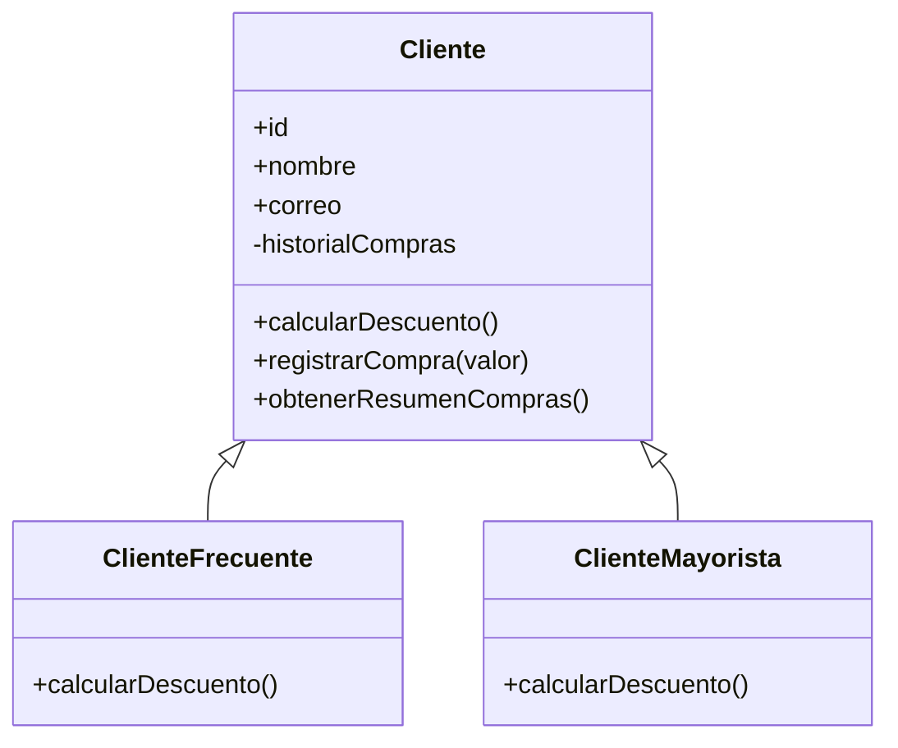

# Actividad 5: diagrama de clases

`historialCompras` se declara como campo privado (`#historialCompras`); solo la clase base lo puede modificar y exponer mediante un resumen controlado. Las dos subclases redefinen `calcularDescuento()` con tasas distintas.